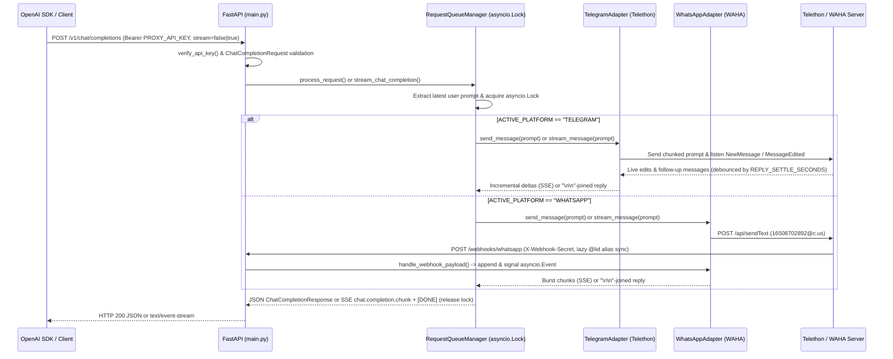

# instinct-openai-proxy

A self-hosted, OpenAI-compatible proxy for messaging-based AI assistants. It lets your scripts and tools talk to [Instinct](https://t.me/textinstinct) on **Telegram** or **WhatsApp** through `POST /v1/chat/completions`, with or without SSE streaming.


> [!WARNING]
> This is an unofficial project for personal experiments. Automating a personal account may break Telegram, WhatsApp or the assistant's terms and can get the account restricted. Everything you send goes through a third-party chat, so don't send secrets, private code or sensitive data.

## Contents

- [How it works](#how-it-works)
- [Limitations](#limitations)
- [Quick start](#quick-start)
- [Usage](#usage)
- [Integrations](#integrations)
- [Docker](#docker)
- [Development](#development)

## How it works

Your client sends a standard OpenAI request. The proxy forwards the prompt to the assistant's chat, waits until the replies go quiet, and returns them as one response (or streams them as they arrive).



### Design decisions

- **One request at a time.** Both platforms use a single chat thread with no request IDs, so an `asyncio.Lock` is held for the whole request, including the full lifetime of a stream. Replies from concurrent clients don't get mixed.
- **Burst accumulation.** Bots often split answers across messages or edit them in place. Messages are tracked by ID and joined once the chat has been silent for `REPLY_SETTLE_SECONDS`, capped by `RESPONSE_TIMEOUT_SECONDS`.
- **Latest user message only.** Instinct keeps its own memory per account, so the proxy doesn't replay the history.
- **WhatsApp `@lid` resolution.** With WAHA's `NOWEB` engine, you send to `@c.us` but replies may arrive from a `@lid` ID. The adapter resolves and caches the mapping at startup and from incoming webhooks.

## Limitations

- Only the latest non-empty `user` message is forwarded. **System prompts and earlier messages in `messages[]` are dropped**, so tools that depend on them may behave differently.
- Context is shared: Instinct remembers previous turns across all your clients, and `/new` doesn't reset it.
- Requests are queued, so this isn't suited to autocomplete, parallel agents or multiple users.
- Only the chat completions and models endpoints of the OpenAI API are provided.

## Quick start

**Requirements:** Python 3.12+, and either a Telegram account with API credentials from [my.telegram.org](https://my.telegram.org), or a WhatsApp account plus Docker (for WAHA).

### 1. Install

```bash
git clone https://github.com/zzzeinhom/instinct-openai-proxy.git
cd instinct-openai-proxy

python -m venv .venv
source .venv/bin/activate        # Windows PowerShell: .venv\Scripts\Activate.ps1
pip install -r requirements.txt
```

### 2. Connect an account

For WhatsApp, start WAHA first:

```bash
docker compose --profile whatsapp up -d waha
```

Then run the setup wizard:

```bash
python setup.py                          # interactive
python setup.py --platform whatsapp      # QR code in the terminal
python setup.py --platform telegram --qr # recommended for Telegram
python setup.py --platform telegram --otp
```

The wizard creates `.env` from `.env.example`, generates `PROXY_API_KEY` and the WAHA secrets if missing, and logs you in. For WhatsApp it also finds Instinct's chat ID.

Keep `.env` and your `.session` files private and out of Git.

### 3. Run

```bash
uvicorn main:app --host 0.0.0.0 --port 8000
curl http://localhost:8000/health
```

`0.0.0.0` makes the server reachable from your network. If you only use Telegram, you can bind to `127.0.0.1` instead.

## Usage

The examples read your key from the shell. Copy `PROXY_API_KEY` from `.env`:

```bash
export PROXY_API_KEY="sk-instinct-your-key"
```

### curl

```bash
# Non-streaming JSON completion
curl http://localhost:8000/v1/chat/completions \
  -H "Authorization: Bearer $PROXY_API_KEY" \
  -H "Content-Type: application/json" \
  -d '{
    "model": "instinct",
    "messages": [{"role": "user", "content": "Summarize how asyncio.Lock works in 2 sentences."}]
  }'

# Real-time SSE streaming
curl -N http://localhost:8000/v1/chat/completions \
  -H "Authorization: Bearer $PROXY_API_KEY" \
  -H "Content-Type: application/json" \
  -d '{
    "model": "instinct",
    "stream": true,
    "messages": [{"role": "user", "content": "Give me three tips for clean Python async code."}]
  }'
```

### OpenAI Python SDK

```python
from openai import OpenAI

client = OpenAI(
    base_url="http://localhost:8000/v1",
    api_key="sk-instinct-your-key",
)

stream = client.chat.completions.create(
    model="instinct",
    messages=[{"role": "user", "content": "Hello Instinct!"}],
    stream=True,
)
for chunk in stream:
    print(chunk.choices[0].delta.content or "", end="", flush=True)
```

### Spring AI (`application.yml`)

```yaml
spring:
  ai:
    openai:
      base-url: http://localhost:8000   # some Spring AI versions expect /v1 here
      api-key: ${PROXY_API_KEY}
      chat:
        options:
          model: instinct
```

## Integrations

Tools that let you set a custom OpenAI base URL are good candidates. Keep the [limitations](#limitations) in mind.

### Continue (VS Code / JetBrains)

Add to `~/.continue/config.yaml`:

```yaml
name: Local
version: 1.0.0
schema: v1
models:
  - name: Instinct (local proxy)
    provider: openai
    model: instinct
    apiBase: http://localhost:8000/v1
    apiKey: sk-instinct-your-key
    roles:
      - chat
```

### Obsidian

In an AI plugin that supports OpenAI-compatible endpoints (such as Text Generator), set the base URL to `http://localhost:8000/v1`, the model to `instinct`, and the API key to your `PROXY_API_KEY`.

### Commit messages from `git diff`

Requires `jq`. Add to `~/.bashrc` or `~/.zshrc`:

```bash
git-ai-commit() {
  local diff
  diff=$(git diff --cached)
  [ -z "$diff" ] && echo "No staged changes." && return 1

  jq -n --arg diff "$diff" '{
    model: "instinct",
    messages: [{
      role: "user",
      content: ("Write a concise Conventional Commit message (1 subject line, optional bullets) for this git diff:\n\n" + $diff)
    }]
  }' | curl -sS http://localhost:8000/v1/chat/completions \
    -H "Authorization: Bearer $PROXY_API_KEY" \
    -H "Content-Type: application/json" \
    -d @- | jq -r '.choices[0].message.content'
}
```

## Docker

**WhatsApp** (after completing the setup above):

```bash
docker compose --profile whatsapp up -d --build
```

**Telegram only** (create the session with `python setup.py --platform telegram --qr` and place the `.session` file in `./sessions`):

```bash
docker compose up -d --build
```

The image is based on `python:3.12-slim` and runs as a non-root user.

## Development

```text
instinct-openai-proxy/
├── main.py                     # FastAPI app, Bearer auth, /v1/* routes & /webhooks/whatsapp
├── config.py                   # Pydantic Settings loaded from .env
├── setup.py                    # Unified interactive/non-interactive CLI onboarding wizard
├── auth_telegram.py            # Thin CLI wrapper for Telegram (--qr / --otp)
├── auth_whatsapp.py            # Thin CLI wrapper for WhatsApp (WAHA)
├── core/
│   ├── models.py               # OpenAI-compatible request & response schemas
│   ├── queue_manager.py        # asyncio.Lock serialization & SSE frame formatting
│   └── env_manager.py          # Idempotent .env helpers & Docker WAHA_API_KEY sync
├── adapters/
│   ├── base_adapter.py         # Unified BaseAdapter ABC (startup, shutdown, send/stream)
│   ├── telegram_adapter.py     # Telethon MTProto adapter with edit/burst debounce
│   └── whatsapp_adapter.py     # WAHA REST + webhook adapter with @lid alias resolution
├── tests/
│   └── test_proxy.py           # Async pytest suite
├── Dockerfile                  # Non-root python:3.12-slim container
├── docker-compose.yml          # instinct-proxy + optional WAHA (whatsapp profile)
├── AGENTS.md                   # Engineering invariants for contributors & coding agents
└── docs/ARCHITECTURE.md        # Detailed sequence & endpoint specification
```

Run the tests:

```bash
pytest -v
```

They cover auth, prompt extraction, request serialization, `@lid` resolution, burst accumulation, webhook secrets and SSE framing.

## Contributing

Read [AGENTS.md](AGENTS.md) and [docs/ARCHITECTURE.md](docs/ARCHITECTURE.md), keep all I/O non-blocking, and make sure `pytest -v` passes.

Ideas open for contribution:

- Adapters for Discord, Slack or Signal (implement `BaseAdapter`)
- Per-key rate limiting and session pooling
- Optional Redis/SQLite conversation store for stateless bots
- OpenTelemetry tracing and Prometheus metrics
