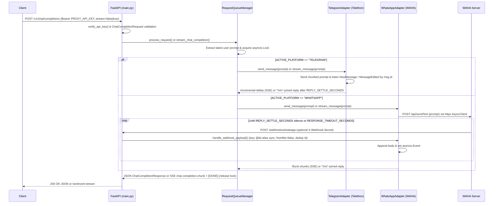

# Architecture

`instinct-openai-proxy` exposes an OpenAI-compatible HTTP API (`POST /v1/chat/completions`) over stateful messaging bots, serializing both non-streaming JSON and SSE streaming requests through a single `asyncio.Lock` while accumulating multi-message replies via a silence debounce window.

## Design Trade-offs

- **Stateful Memory-Backed Assistant:** Instinct (`@textinstinct`) maintains persistent account-level conversational memory across turns on both WhatsApp and Telegram (ignoring stateless reset commands like `/new`). Consequently, `instinct-openai-proxy` forwards only the latest `user` prompt from incoming `messages[]` directly without synthetic reset round-trips or redundant history replay.
- **Single-Concurrency Mutex:** Upstream bot replies share a single conversation thread, so `RequestQueueManager` holds an `asyncio.Lock` across the entire completion or SSE stream.

## Request Lifecycle

## Authentication, Alias Sync & Containerization

- **Unified Setup Wizard (`python setup.py`):** Initializes `.env` and `PROXY_API_KEY` / `WAHA_*` secrets via `core/env_manager.py`, lets users pick WhatsApp (`[1]`) or Telegram (`[2]`), runs terminal QR/OTP auth, and saves `INSTINCT_WA_NUMBER` (defaulting to `16508702892@c.us` if no chat exists yet) or `TG_API_ID` / `TG_API_HASH` / `.session`.
- **`@c.us` <-> `@lid` Resolution:** `WhatsAppAdapter._sync_contact_aliases()` queries `/api/{session}/lids/pn/{digits}` and inspects top-level and nested `_chat` fields from `/chats/overview` and `/chats` (`limit=50`) on `startup()` and lazily on the first inbound `@lid` webhook (also auto-trusting `_data.key.remoteJidAlt`/`participantAlt`) so outbound `16508702892@c.us` messages seamlessly match user-scoped `@lid` replies.
- **Docker Compose:** `Dockerfile` builds a non-root `python:3.12-slim` image; `docker-compose.yml` runs `instinct-proxy` (persisting Telegram sessions via `TG_SESSION_DIR=/app/sessions`) alongside an optional `waha` service under `profiles: ["whatsapp"]`.

## Endpoints & API Contract

- `POST /v1/chat/completions`, `GET /v1/models`: protected by `Authorization: Bearer <PROXY_API_KEY>` when `PROXY_API_KEY` is non-empty. Supports `stream: false` (JSON `chat.completion`) and `stream: true` (`text/event-stream` `chat.completion.chunk` + `data: [DONE]`).
- `POST /webhooks/whatsapp`: outside `/v1/*` Bearer auth; validates `X-Webhook-Secret` when `WAHA_WEBHOOK_SECRET` is configured and forwards payloads to `WhatsAppAdapter.handle_webhook_payload()`.
- `GET /health`: unauthenticated liveness check returning `{"status": "ok", "platform": ACTIVE_PLATFORM}`.
